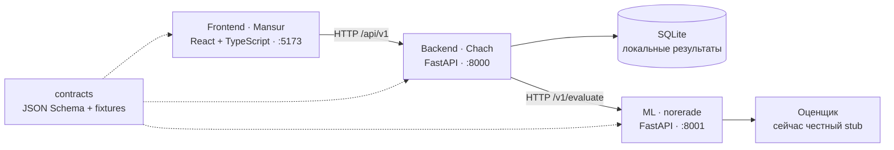

# EVA — Expert Virtual Auditor

Основа командного проекта для CQA-хакатона Freedom Broker. Оцениваем работу оператора по настраиваемому чек-листу, объясняем каждый вывод и связываем его с репликой. Итоговая цель — поддержать пересмотр результата через апелляцию.

**Сейчас это запускаемый каркас для параллельной разработки.** Есть общий контракт, синтетическое демо, начальный интерфейс, сервер с расчётом баллов и сохранением оценки, независимая ML-заглушка. Реальная модель, импорт DEV, редактор чек-листа и апелляции — следующие задачи; полный продукт ещё не готов.

## Кто за что отвечает

**Все работают только в `main`. ИИ запрещено создавать новые ветки/worktree и переключать ветку.** Разделение работы идёт по папкам, а не по веткам. Если открыта другая ветка, ИИ сообщает человеку и не начинает изменения.

| Участник | Подкатегория | Рабочая папка | Личный README |
|---|---|---|---|
| **Mansur** | **Frontend** | `frontend/` | [Начать Mansur](frontend/README.md) |
| **Chach** | **Backend** | `backend/` | [Начать Chach](backend/README.md) |
| **norerade** | **ML engineer** | `ml/` | [Начать norerade](ml/README.md) |

У каждого собственные зависимости, тесты, настройки и очередь задач. Общие файлы — `contracts/`, `docs/`, `tools/` и корень — ролевые ИИ не меняют. Все операции Git/GitHub делает человек: **ИИ не коммитит, не пушит, не создаёт PR и не меняет чужую часть**. Полные правила: [AGENTS.md](AGENTS.md).

## Архитектура



Backend владеет хранением, проверкой результата, расчётом баллов и будущими апелляциями. ML владеет интерпретацией критериев и доказательствами. Frontend владеет взаимодействием с пользователем. Между частями — HTTP и версионируемые данные, без общих исходных модулей и прямого доступа к чужой базе.

## Запуск

Нужны Node.js 22.12+ и Python 3.11+. Каждый участник может запускать только свою часть; полная проверка выполняется человеком или в явно назначенной интеграционной задаче.

**Frontend отдельно:**

```powershell
cd frontend
npm ci
npm run dev
```

Открыть `http://localhost:5173`. По умолчанию используется синтетический пример с ручной разметкой. Он не требует серверов или ключей.

**Полный локальный маршрут** — в трёх отдельных терминалах, из корня проекта:

```powershell
cd ml
python -m venv .venv
.\.venv\Scripts\python -m pip install -r requirements-dev.txt
.\.venv\Scripts\python -m uvicorn eva_ml.app:app --host 127.0.0.1 --port 8001
```

```powershell
cd backend
python -m venv .venv
.\.venv\Scripts\python -m pip install -r requirements-dev.txt
.\.venv\Scripts\python -m uvicorn app.main:app --host 127.0.0.1 --port 8000
```

```powershell
cd frontend
npm ci
$env:VITE_API_MODE='http'
$env:VITE_API_URL='http://127.0.0.1:8000'
npm run dev
```

Адреса и точные переменные окружения также описаны в README каждой роли. В HTTP-режиме ML пока возвращает `needs_review`, итог — `null`. Это ожидаемая работа заглушки; 100 баллов из демо не переносится в реальную оценку. Без ML Backend вернёт ошибку доступности сервиса.

## Проверки перед передачей работы

| Зона | Проверка |
|---|---|
| Frontend | `npm run build` из `frontend/` |
| Backend | `.\.venv\Scripts\python -m pytest` из `backend/` |
| ML | `.\.venv\Scripts\python -m pytest` из `ml/` |
| Общие примеры | `python tools/check_contracts.py` из корня, окружение с `jsonschema` и `referencing` |
| Область изменений | `python tools/check_scope.py --role frontend` (или `backend`, `ml`) |

Scope-проверка сравнивает локальные изменения с человеческой базовой фиксацией. До первого commit исходной базы она закономерно увидит все новые файлы; фиксацию выполняет человек.

## С чего продолжить

1. Прочитать [выжимку ТЗ](docs/REQUIREMENTS.md), [архитектуру](docs/ARCHITECTURE.md) и [контракты](contracts/README.md).
2. Открыть личный README и выдать ИИ стартовый запрос из него. Работать в своей папке.
3. Брать небольшие задачи из [плана на 24 часа](docs/ROADMAP.md). Пересечения оформлять в своём `CHANGE_REQUESTS.md`.
4. Использовать [подборку skills с GitHub](docs/SKILLS.md) по назначению и ограничениям. Ничего не установлено глобально автоматически.

Исходные PDF и реальные данные в репозиторий не копировались. Источники и отличия требований от архитектурных решений отмечены в `docs/REQUIREMENTS.md`.
